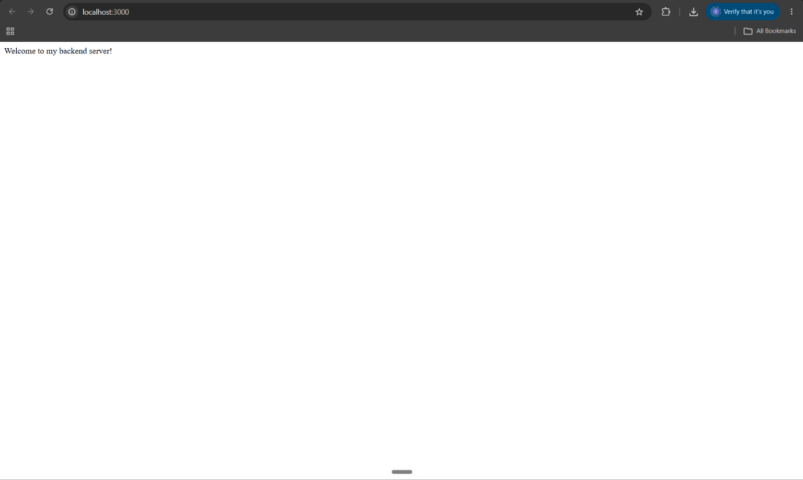
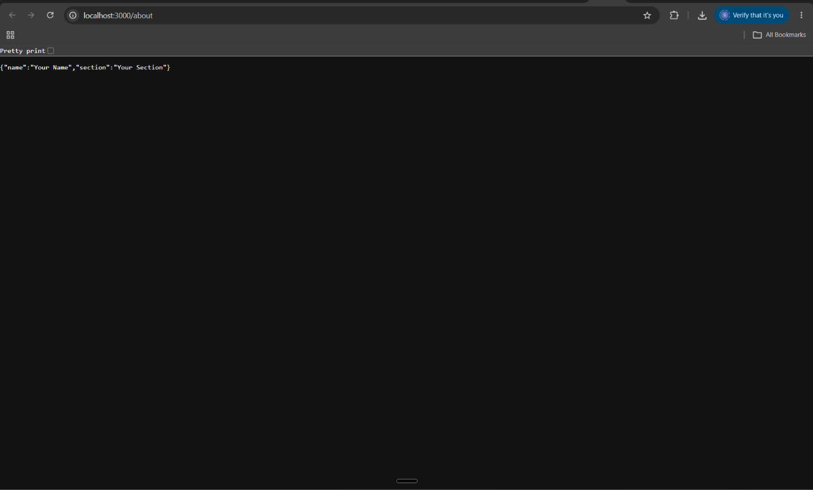
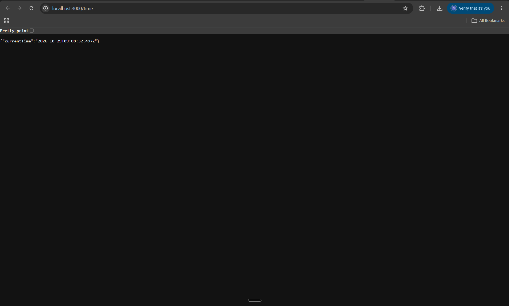
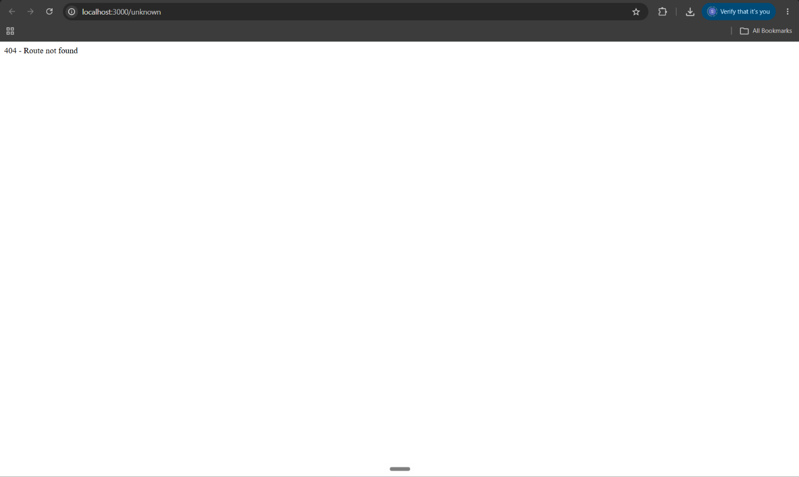

# Lab 1: Node.js and Express Server

## Student Details

- **Name:** Prem
- **Registration Number:** 252U1R5124
- **Section:** AIDE-2B-313

## Description

This project demonstrates how to create a web server using Node.js and Express.js. It includes basic routing, JSON responses, date and time handling, and 404 error handling.

## Technologies Used

- Node.js
- Express.js
- npm

## Prerequisites

- Node.js installed
- npm installed

## Installation and Setup

1. Clone or download this repository.
2. Open the project folder in the terminal.
3. Install the dependencies:

   ```bash
   npm install
   ```

4. Start the server:

   ```bash
   node index.js
   ```

5. Open `http://localhost:3000` in your browser.

## API Endpoints

| HTTP Method | Endpoint | Description | Expected Status |
|---|---|---|---|
| GET | `/` | Displays a welcome message | 200 OK |
| GET | `/about` | Returns the student's name and section as JSON | 200 OK |
| GET | `/time` | Returns the current date and time | 200 OK |
| GET | `/unknown` | Demonstrates handling of an unknown route | 404 Not Found |

## Screenshots

### 1. Home Route



### 2. About Route



### 3. Time Route



### 4. Unknown Route



## HTTP Status Code Verification

The routes were tested in a web browser using the Developer Tools Network tab.

| Endpoint | Status Code |
|---|---|
| `/` | 200 |
| `/about` | 200 |
| `/time` | 200 |
| `/unknown` | 404 |

## Problems Faced and Solutions

Document any errors encountered during development and how they were resolved.

## Deployment

**Live URL:** Not deployed yet.