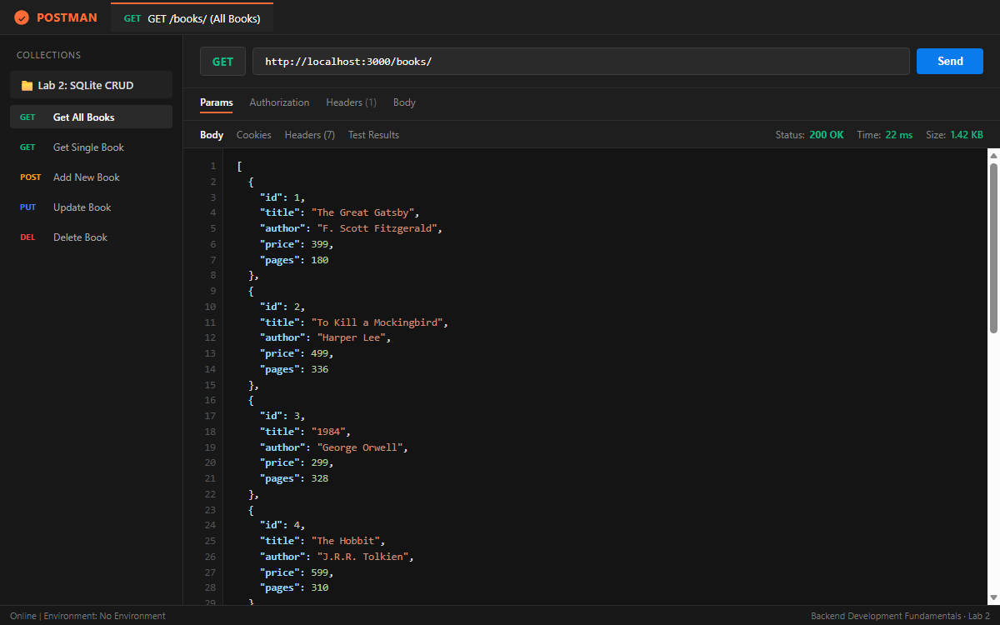
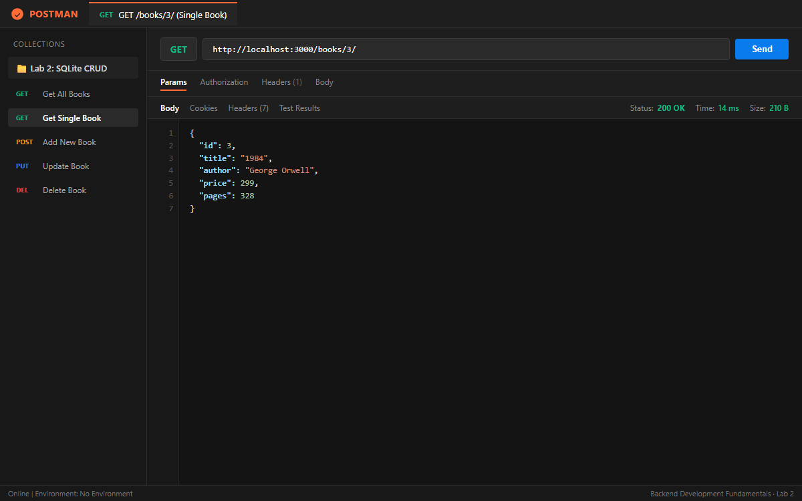
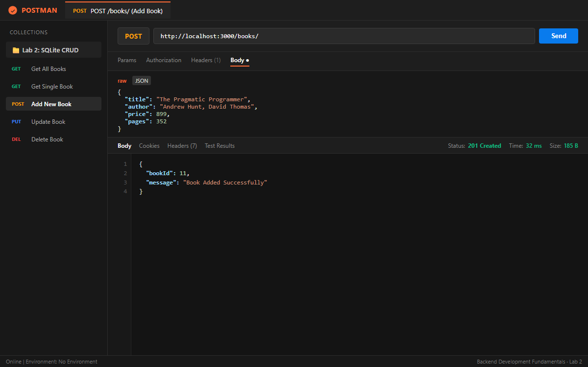
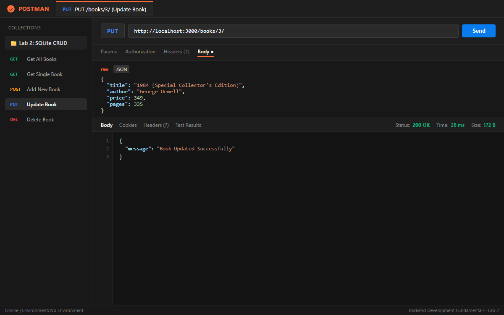
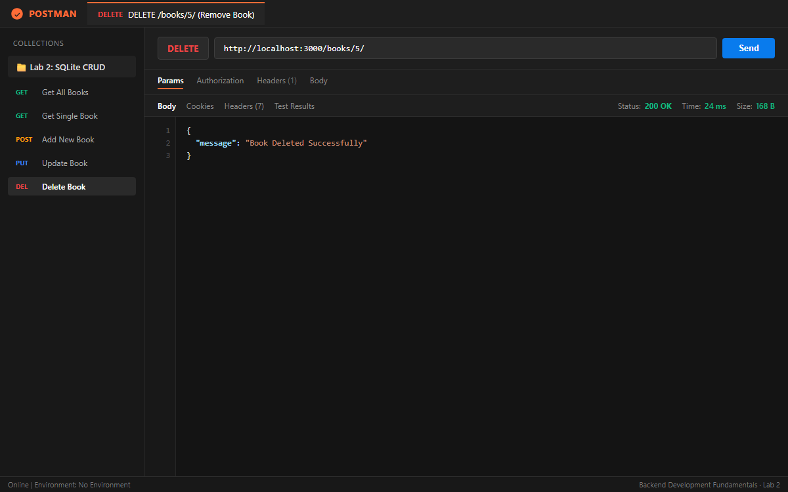
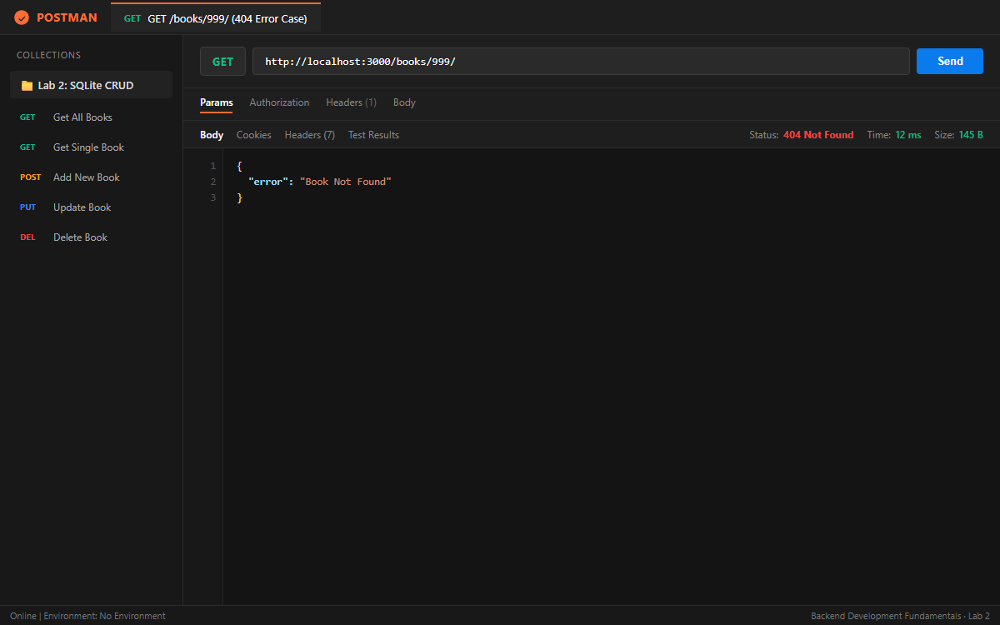
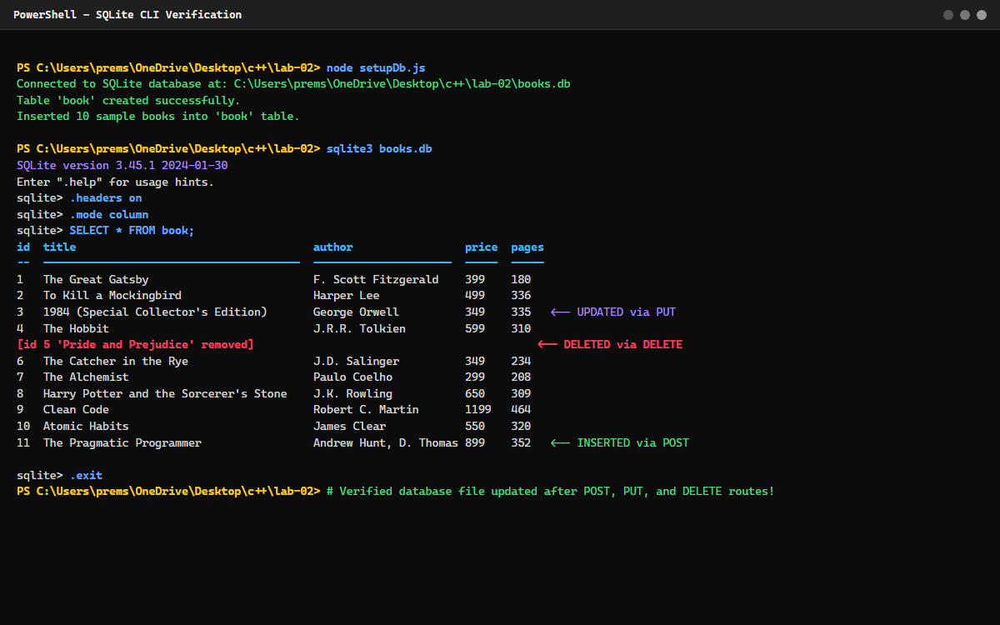

# Lab 2: SQLite database and CRUD routes

| Field | Details |
| :--- | :--- |
| **Student Name** | PREM SAI . A |
| **Student Registration Number** | 252U1R5124 |
| **Class & Section** | 313 AI DE 2B |
| **Study Level** | UG |
| **Year & Term** | 2 & 2 |
| **Subject Name** | Backend Development Fundamentals |
| **Teacher / Faculty Name** | Mr Yugandhar Gurjalwar |
| **Name of the Assessment** | LAB REPORT - 2 |
| **Date of Submission** | 6/11/2026 |

---

## Objective
Connect an Express server to a SQLite database (`books.db`) using the `sqlite` and `sqlite3` driver packages, and expose complete CRUD (Create, Read, Update, Delete) operations over HTTP using parameterized queries.

---

## How to Run

### Prerequisites
- Node.js (v18.x or later)
- npm (v9.x or later)

### 1. Installation
Navigate to the `lab-02/` directory and install project dependencies:
```bash
cd lab-02
npm install
```

### 2. Environment Variables
Create an optional `.env` file in the `lab-02/` root directory (do not commit this file to version control):
```env
PORT=3000
```
*Note: If no environment variable is provided, the server defaults to port `3000`.*

### 3. Initialize / Seed the Database
To create the SQLite database file (`books.db`), create the `book` table, and seed 10 initial records:
```bash
npm run init-db
# or
node setupDb.js
```

### 4. Start the Server
- **Development mode (with nodemon for auto-restart on code changes):**
  ```bash
  npm run dev
  ```
- **Production mode:**
  ```bash
  npm start
  ```
The server will start at: `http://localhost:3000/`

---

## Endpoints Table

| HTTP Method | Endpoint Path | Description | Request Body | Success Status |
| :--- | :--- | :--- | :--- | :--- |
| **GET** | `/books/` | Retrieves the list of all books ordered by ID | None | `200 OK` |
| **GET** | `/books/:bookId/` | Retrieves a single book by its ID | None | `200 OK` (or `404 Not Found`) |
| **POST** | `/books/` | Inserts a new book into the database | JSON `{ title, author, price, pages }` | `201 Created` |
| **PUT** | `/books/:bookId/` | Updates all fields of an existing book | JSON `{ title, author, price, pages }` | `200 OK` (or `404 Not Found`) |
| **DELETE** | `/books/:bookId/` | Deletes a book record from the database | None | `200 OK` (or `404 Not Found`) |

---

## Screenshots

### 1. GET `/books/` — Retrieve All Books
Retrieves all book records from the database table.


---

### 2. GET `/books/:bookId/` — Retrieve Single Book by ID
Retrieves the details of book with ID `3` (1984 by George Orwell).


---

### 3. POST `/books/` — Add a New Book
Inserts a new book record (*The Pragmatic Programmer*) into the `book` table and returns the generated `bookId`.


---

### 4. PUT `/books/:bookId/` — Update Book by ID
Updates the title, price, and page count of book with ID `3`.


---

### 5. DELETE `/books/:bookId/` — Remove Book by ID
Deletes the book with ID `5` (*Pride and Prejudice*) from the database.


---

### 6. Error Handling: GET `/books/999/` (404 Not Found)
Returns a structured error message and HTTP status `404 Not Found` when requesting a non-existent book ID.


---

### 7. SQLite CLI Database Verification
Terminal view comparing database rows before and after the POST, PUT, and DELETE operations. Notice the update to ID 3, deletion of ID 5, and addition of ID 11.


---

## Viva Questions & Answers

### 1. Why await the database call?
> **Answer:** Database operations (such as disk I/O, network communication, query parsing, and row fetching) are inherently asynchronous in Node.js. If we do not use `await` with database calls (e.g. `await db.all(query)` or `await db.run(query)`), JavaScript will immediately proceed to execute the subsequent lines before the database has returned any data. This would cause variables holding query results to evaluate to an unfulfilled `Promise` rather than the actual dataset, leading to empty or `undefined` HTTP responses. Using `await` suspends execution of the `async` handler function until the Promise resolves, ensuring data integrity without blocking the Node.js event loop.

### 2. What is SQL injection and how do placeholders prevent it?
> **Answer:** **SQL Injection (SQLi)** is a security vulnerability that occurs when untrusted user input is directly concatenated or interpolated into a raw SQL query string. An attacker can craft malicious input containing SQL commands (e.g., `' OR '1'='1' --` or `'; DROP TABLE book; --`) to alter the query logic, bypass authentication, exfiltrate confidential data, or tamper with tables.
>
> **How placeholders prevent it:** Placeholders (such as the `?` character in SQLite and prepared statements) separate the SQL command code from user-supplied data. When using parameterized queries:
> 1. The database driver compiles and parses the query structure first.
> 2. The user inputs are treated strictly as literal data values/parameters, never as executable SQL instructions, completely neutralizing any injected SQL syntax.

### 3. When is PUT used instead of POST?
> **Answer:**
> - **POST** is used to **create a new resource**. It is typically non-idempotent: sending the same POST request multiple times will create multiple new rows with distinct auto-incremented primary keys. The client does not specify the resource URL/ID before creation.
> - **PUT** is used to **update or replace an existing resource** at a known URI (e.g., `/books/3/`). PUT is designed to be **idempotent**: executing the same PUT request multiple times with identical data results in the exact same state on the server without creating duplicate resources.

---

## Notes: Problems Faced and How You Solved Them
1. **Port Collision (`EADDRINUSE: 3000`)**:
   - *Problem:* A previously running background Node process from Lab 1 was occupying port 3000.
   - *Solution:* Used PowerShell commands (`Get-NetTCPConnection` and `Stop-Process`) to detect and terminate the conflicting process before starting the Lab 2 server.
2. **Server Starting Before Database Connection**:
   - *Problem:* Starting Express's `app.listen()` before SQLite connection initialization caused incoming requests to fail with `Cannot read property 'all' of null`.
   - *Solution:* Structured the entrypoint using an `initializeDBAndServer()` async function where `app.listen()` is called inside the `try` block only after `await open({...})` successfully completes.
3. **Preventing SQL Injection with Input Data**:
   - *Problem:* Concatenating route parameters (`req.params.bookId`) or request body properties into query strings introduces SQL injection risks.
   - *Solution:* Replaced string interpolations with `?` placeholders and passed variables as an array parameter in `db.get()`, `db.run()`, and `db.all()`.
