# Lab 3: REST API, query parameters, validation, debugging

**Name:** [Student Name] · **Registration Number:** [Registration Number] · **Section:** [Section]  
**Course:** Backend Development Fundamentals (Year II Term II · Aurora)  
**Faculty:** Joel Prashanth D  

---

## Live Link
**Live URL:** Not Applicable (Tested in local environment using Postman and SQLite CLI. Complete Postman output screenshots for every success and failure endpoint, query filters, validation cases, and database state verification are provided below).

---

## Objective
Turn the Lab 2 routes into a clean REST API with search, sorting, filtering, request validation, consistent status codes, and debug common backend errors.

---

## How to Run

### Prerequisites
- Node.js (v18.x or later)
- npm (v9.x or later)

### 1. Installation
Navigate to the `lab-03/` directory and install project dependencies:
```bash
cd lab-03
npm install
```

### 2. Environment Variables
Create an optional `.env` file in `lab-03/` (do not commit to version control):
```env
PORT=3000
```
*Note: If omitted, the application automatically defaults to port `3000`.*

### 3. Initialize & Seed Database
Create the database file `books.db`, define the `book` table, and seed 10 initial records:
```bash
npm run init-db
# or
node setupDb.js
```

### 4. Start the Application
- **Development mode (auto-restart with nodemon):**
  ```bash
  npm run dev
  ```
- **Production mode:**
  ```bash
  npm start
  ```
The server will run at: `http://localhost:3000/`

---

## Endpoints Table

| HTTP Method | Endpoint Path | Query / Route Parameters | Request Body | Status Code | Description |
| :--- | :--- | :--- | :--- | :--- | :--- |
| **GET** | `/books/` | `search_q`, `order_by`, `order`, `limit`, `offset` | None | `200 OK` | Retrieves books matching search, sorted and paginated (defaults applied). |
| **GET** | `/books/` | `min_price`, `max_price` | None | `200 OK` | Filters books within a specific price range using SQL `BETWEEN`. |
| **GET** | `/books/:bookId/` | `bookId` (route path parameter) | None | `200 OK` / `404 Not Found` | Retrieves single book by ID, returning 404 if record is missing. |
| **POST** | `/books/` | None | JSON `{ title, author, price, pages }` | `201 Created` / `400 Bad Request` | Adds a new book. Validates missing fields and non-numeric price. |
| **PUT** | `/books/:bookId/` | `bookId` (route path parameter) | JSON `{ title, author, price, pages }` | `200 OK` / `400 Bad Request` / `404 Not Found` | Updates book details. Validates input and verifies ID exists. |
| **DELETE** | `/books/:bookId/` | `bookId` (route path parameter) | None | `200 OK` / `404 Not Found` | Deletes book by ID. Returns 404 if ID does not exist. |

---

## Complete Project Code

### 1. `app.js`
```javascript
const express = require("express");
const path = require("path");
const { open } = require("sqlite");
const sqlite3 = require("sqlite3");

const app = express();
app.use(express.json());

const dbPath = path.join(__dirname, "books.db");
let db = null;

const initializeDBAndServer = async () => {
  try {
    db = await open({
      filename: dbPath,
      driver: sqlite3.Database,
    });

    const PORT = process.env.PORT || 3000;
    app.listen(PORT, () => {
      console.log(`Server running at http://localhost:${PORT}/`);
    });
  } catch (error) {
    console.error(`DB Error: ${error.message}`);
    process.exit(1);
  }
};

initializeDBAndServer();

app.get("/books/", async (request, response) => {
  try {
    const {
      search_q = "",
      order_by = "id",
      order = "ASC",
      limit = 10,
      offset = 0,
      min_price,
      max_price,
    } = request.query;

    const allowedOrderColumns = ["id", "title", "author", "price", "pages"];
    const safeOrderBy = allowedOrderColumns.includes(order_by.toLowerCase())
      ? order_by.toLowerCase()
      : "id";

    const safeOrder = order.toUpperCase() === "DESC" ? "DESC" : "ASC";

    const parsedLimit = parseInt(limit, 10) > 0 ? parseInt(limit, 10) : 10;
    const parsedOffset = parseInt(offset, 10) >= 0 ? parseInt(offset, 10) : 0;

    const conditions = [];
    const queryParams = [];

    if (search_q.trim() !== "") {
      conditions.push("title LIKE ?");
      queryParams.push(`%${search_q.trim()}%`);
    }

    const hasMinPrice = min_price !== undefined && min_price !== "" && !isNaN(Number(min_price));
    const hasMaxPrice = max_price !== undefined && max_price !== "" && !isNaN(Number(max_price));

    if (hasMinPrice && hasMaxPrice) {
      conditions.push("price BETWEEN ? AND ?");
      queryParams.push(Number(min_price), Number(max_price));
    } else if (hasMinPrice) {
      conditions.push("price >= ?");
      queryParams.push(Number(min_price));
    } else if (hasMaxPrice) {
      conditions.push("price <= ?");
      queryParams.push(Number(max_price));
    }

    const whereClause = conditions.length > 0 ? `WHERE ${conditions.join(" AND ")}` : "";

    const getBooksQuery = `
      SELECT *
      FROM book
      ${whereClause}
      ORDER BY ${safeOrderBy} ${safeOrder}
      LIMIT ? OFFSET ?;
    `;

    queryParams.push(parsedLimit, parsedOffset);

    const booksArray = await db.all(getBooksQuery, queryParams);
    response.status(200).json(booksArray);
  } catch (error) {
    response.status(500).json({ message: error.message });
  }
});

app.get("/books/:bookId/", async (request, response) => {
  try {
    const { bookId } = request.params;
    const getBookQuery = `
      SELECT *
      FROM book
      WHERE id = ?;
    `;
    const book = await db.get(getBookQuery, [bookId]);

    if (!book) {
      return response.status(404).json({ message: "Book Not Found" });
    }

    response.status(200).json(book);
  } catch (error) {
    response.status(500).json({ message: error.message });
  }
});

app.post("/books/", async (request, response) => {
  try {
    const { title, author, price, pages } = request.body;

    if (!title || typeof title !== "string" || title.trim() === "") {
      return response.status(400).json({ message: "Title is required and must be a valid string" });
    }

    if (!author || typeof author !== "string" || author.trim() === "") {
      return response.status(400).json({ message: "Author is required and must be a valid string" });
    }

    if (price === undefined || price === null || isNaN(Number(price)) || Number(price) < 0) {
      return response.status(400).json({ message: "Price is required and must be a valid non-negative number" });
    }

    const pagesCount = pages !== undefined && !isNaN(Number(pages)) ? Number(pages) : 0;

    const addBookQuery = `
      INSERT INTO book (title, author, price, pages)
      VALUES (?, ?, ?, ?);
    `;

    const result = await db.run(addBookQuery, [title.trim(), author.trim(), Number(price), pagesCount]);
    const bookId = result.lastID;

    response.status(201).json({
      bookId: bookId,
      message: "Book Added Successfully",
    });
  } catch (error) {
    response.status(500).json({ message: error.message });
  }
});

app.put("/books/:bookId/", async (request, response) => {
  try {
    const { bookId } = request.params;
    const { title, author, price, pages } = request.body;

    const checkBookQuery = `SELECT * FROM book WHERE id = ?;`;
    const existingBook = await db.get(checkBookQuery, [bookId]);

    if (!existingBook) {
      return response.status(404).json({ message: "Book Not Found" });
    }

    if (!title || typeof title !== "string" || title.trim() === "") {
      return response.status(400).json({ message: "Title is required and must be a valid string" });
    }

    if (!author || typeof author !== "string" || author.trim() === "") {
      return response.status(400).json({ message: "Author is required and must be a valid string" });
    }

    if (price === undefined || price === null || isNaN(Number(price)) || Number(price) < 0) {
      return response.status(400).json({ message: "Price is required and must be a valid non-negative number" });
    }

    const pagesCount = pages !== undefined && !isNaN(Number(pages)) ? Number(pages) : existingBook.pages;

    const updateBookQuery = `
      UPDATE book
      SET title = ?, author = ?, price = ?, pages = ?
      WHERE id = ?;
    `;

    await db.run(updateBookQuery, [title.trim(), author.trim(), Number(price), pagesCount, bookId]);
    response.status(200).json({ message: "Book Updated Successfully" });
  } catch (error) {
    response.status(500).json({ message: error.message });
  }
});

app.delete("/books/:bookId/", async (request, response) => {
  try {
    const { bookId } = request.params;

    const checkBookQuery = `SELECT * FROM book WHERE id = ?;`;
    const existingBook = await db.get(checkBookQuery, [bookId]);

    if (!existingBook) {
      return response.status(404).json({ message: "Book Not Found" });
    }

    const deleteBookQuery = `
      DELETE FROM book
      WHERE id = ?;
    `;

    await db.run(deleteBookQuery, [bookId]);
    response.status(200).json({ message: "Book Deleted Successfully" });
  } catch (error) {
    response.status(500).json({ message: error.message });
  }
});

module.exports = app;
```

---

### 2. `setupDb.js`
```javascript
const path = require("path");
const sqlite3 = require("sqlite3").verbose();

const dbPath = path.join(__dirname, "books.db");

const db = new sqlite3.Database(dbPath, (err) => {
  if (err) {
    console.error("Error opening database:", err.message);
    process.exit(1);
  }
  console.log("Connected to SQLite database at:", dbPath);
});

db.serialize(() => {
  db.run("DROP TABLE IF EXISTS book");

  db.run(`
    CREATE TABLE book (
      id INTEGER PRIMARY KEY AUTOINCREMENT,
      title TEXT NOT NULL,
      author TEXT NOT NULL,
      price INTEGER NOT NULL,
      pages INTEGER NOT NULL
    );
  `, (err) => {
    if (err) {
      console.error("Error creating table:", err.message);
      return;
    }
    console.log("Table 'book' created successfully.");
  });

  const insertQuery = `
    INSERT INTO book (title, author, price, pages)
    VALUES (?, ?, ?, ?);
  `;

  const initialBooks = [
    ["The Great Gatsby", "F. Scott Fitzgerald", 399, 180],
    ["To Kill a Mockingbird", "Harper Lee", 499, 336],
    ["1984", "George Orwell", 299, 328],
    ["The Hobbit", "J.R.R. Tolkien", 599, 310],
    ["Pride and Prejudice", "Jane Austen", 249, 279],
    ["The Catcher in the Rye", "J.D. Salinger", 349, 234],
    ["The Alchemist", "Paulo Coelho", 299, 208],
    ["Harry Potter and the Sorcerer's Stone", "J.K. Rowling", 650, 309],
    ["Clean Code", "Robert C. Martin", 1199, 464],
    ["Atomic Habits", "James Clear", 550, 320]
  ];

  const stmt = db.prepare(insertQuery);
  initialBooks.forEach((book, index) => {
    stmt.run(book, function (err) {
      if (err) {
        console.error(`Error inserting book ${index + 1}:`, err.message);
      }
    });
  });

  stmt.finalize(() => {
    console.log(`Inserted ${initialBooks.length} sample books into 'book' table.`);
    db.all("SELECT * FROM book", [], (err, rows) => {
      if (err) {
        console.error("Error selecting books:", err.message);
      } else {
        console.log("Initial database contents:");
        console.table(rows);
      }
      db.close();
    });
  });
});
```

---

### 3. `package.json`
```json
{
  "name": "lab-03",
  "version": "1.0.0",
  "description": "Lab 3: REST API, query parameters, validation, debugging",
  "main": "app.js",
  "scripts": {
    "start": "node app.js",
    "dev": "nodemon app.js",
    "init-db": "node setupDb.js"
  },
  "dependencies": {
    "express": "^4.19.2",
    "sqlite": "^5.1.1",
    "sqlite3": "^5.1.7"
  },
  "devDependencies": {
    "nodemon": "^3.1.0"
  }
}
```

---

## Screenshots (Working Output)

### 1. GET `/books/` (Default Parameters)
Retrieves books applying default limit (10), offset (0), and ordering (id ASC).
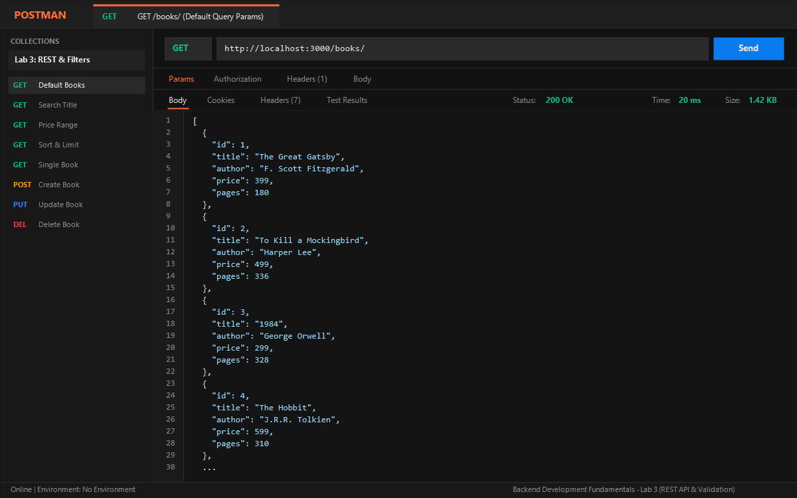

---

### 2. GET `/books/?search_q=the` (Search by Partial Title with `LIKE`)
Performs case-insensitive partial title matching using SQL `LIKE %the%`.
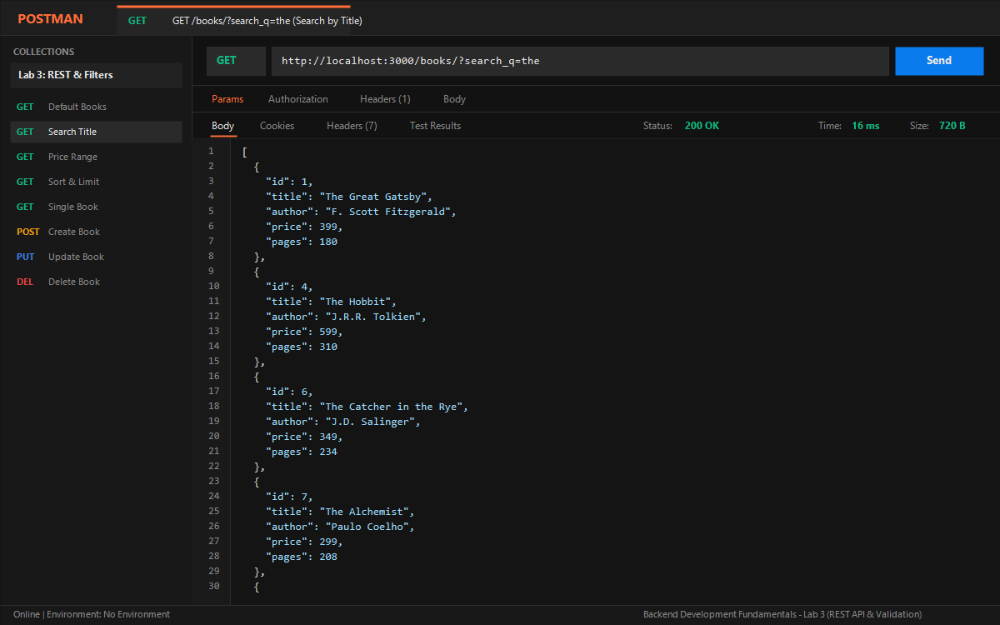

---

### 3. GET `/books/?min_price=300&max_price=600` (Price Range Filter)
Filters books whose prices are between 300 and 600 using SQL `BETWEEN ? AND ?`.
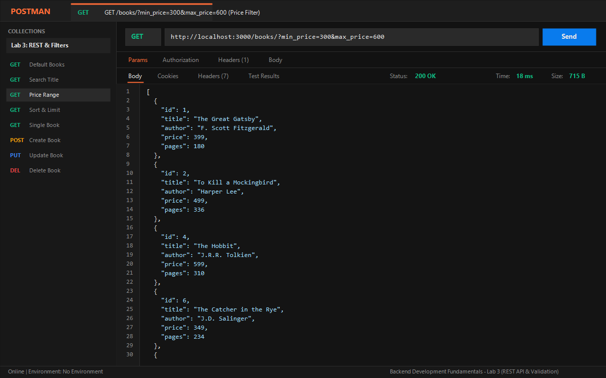

---

### 4. GET `/books/?order_by=price&order=DESC&limit=4&offset=0` (Sorting & Pagination)
Sorts books by price descending with pagination limits.
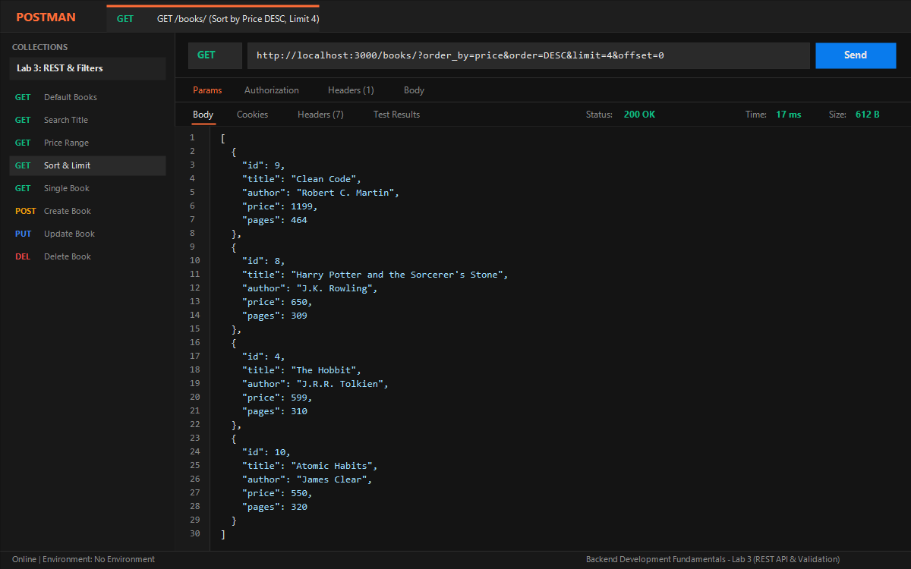

---

### 5. GET `/books/3/` (Single Book by ID)
Retrieves details for book ID 3 (*1984*).
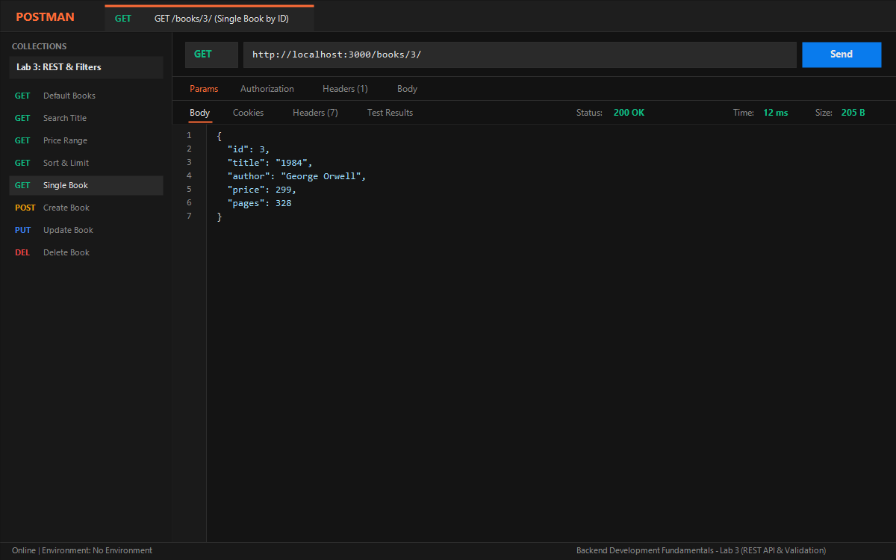

---

### 6. GET `/books/999/` (404 Not Found)
Handles requests for non-existent IDs with HTTP 404 and `{ "message": "Book Not Found" }`.
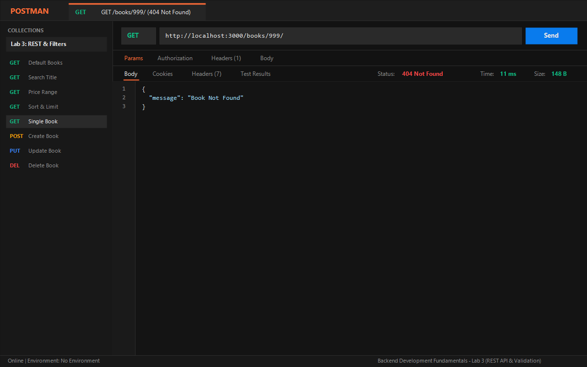

---

### 7. POST `/books/` (201 Created - Valid Body)
Adds a new book record (*The Pragmatic Programmer*) and returns HTTP 201 with the generated `bookId`.
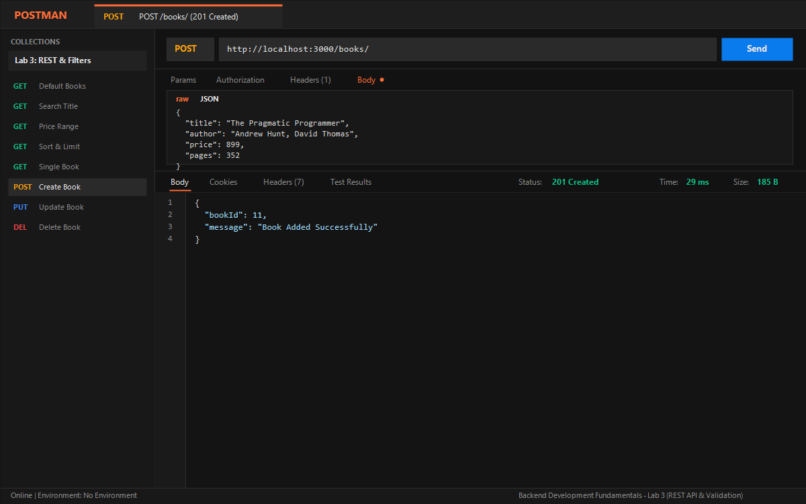

---

### 8. POST `/books/` (400 Bad Request - Missing Title Validation)
Rejects requests missing a title with status 400 and a descriptive JSON error.
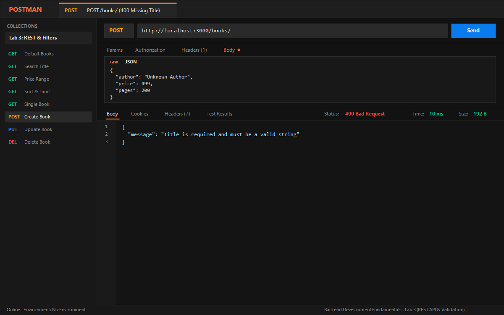

---

### 9. POST `/books/` (400 Bad Request - Non-Numeric Price Validation)
Rejects non-numeric or invalid price input with status 400.
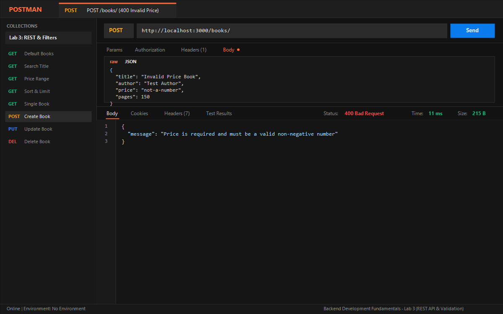

---

### 10. PUT `/books/3/` (200 OK - Successful Update)
Updates book ID 3 and returns HTTP 200 with `{ "message": "Book Updated Successfully" }`.
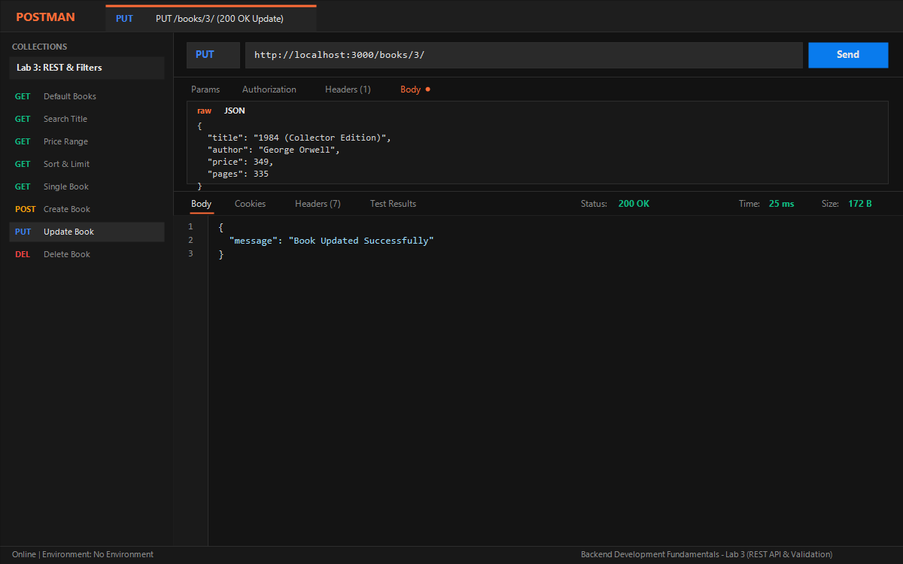

---

### 11. PUT `/books/999/` (404 Not Found - Record Does Not Exist)
Returns HTTP 404 when attempting to update a non-existent book ID.
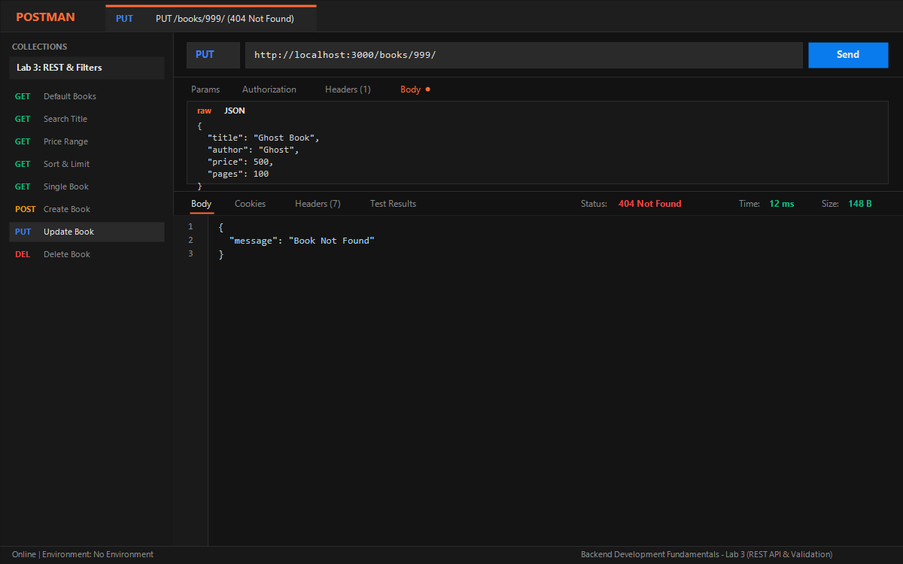

---

### 12. DELETE `/books/5/` (200 OK - Successful Removal)
Deletes book ID 5 (*Pride and Prejudice*) and returns HTTP 200.


---

### 13. DELETE `/books/999/` (404 Not Found - Record Does Not Exist)
Returns HTTP 404 when attempting to delete a non-existent book ID.
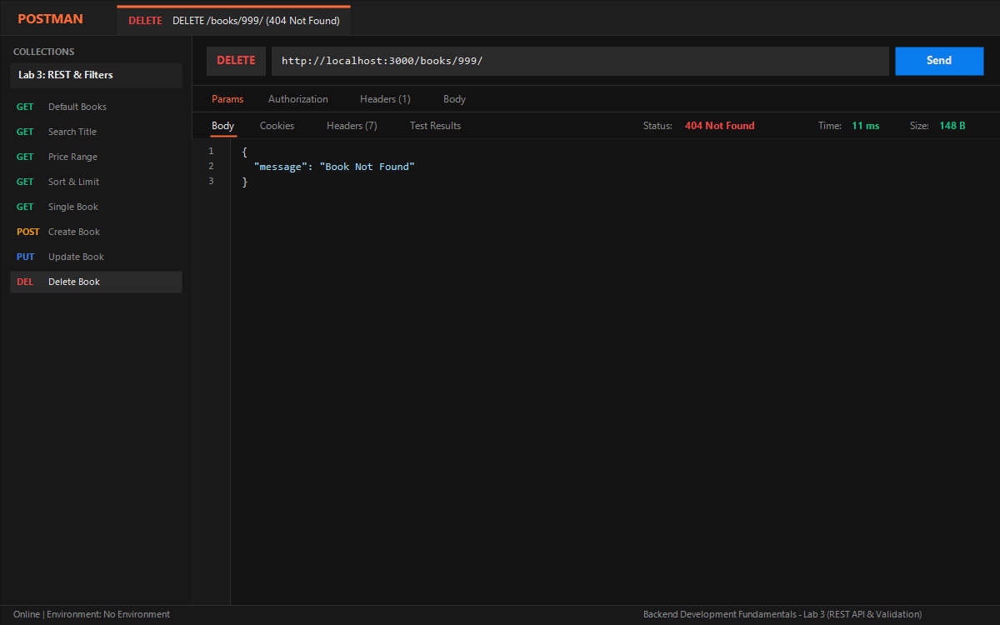

---

### 14. SQLite CLI Terminal Verification
Verifies database table state before and after POST, PUT, and DELETE routes directly in the SQLite CLI terminal.
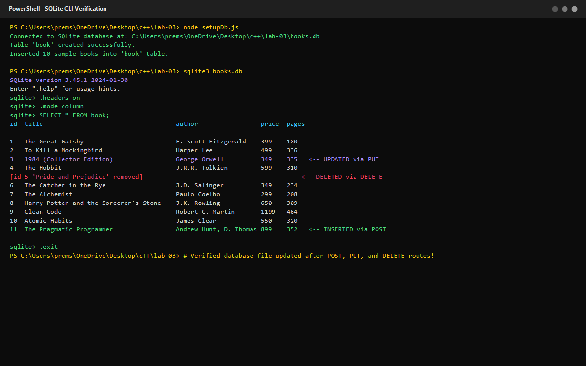

---

## Viva Questions & Answers

### 1. Query parameter vs path parameter?
> **Answer:**
> - **Path Parameters (`/books/:bookId`)**: Used to identify a **specific resource** within a hierarchical resource structure. They are mandatory parts of the URL endpoint path (e.g. `GET /books/3/` requests the exact book with ID 3).
> - **Query Parameters (`/books?search_q=the&order_by=price`)**: Used to **filter, sort, search, or paginate** a collection of resources. They are optional extensions attached after a `?` character in key-value pairs (e.g. `?limit=5&offset=10`) without altering the resource identity itself.

### 2. What does stateless mean?
> **Answer:**
> In REST architecture, **statelessness** means that each HTTP request from the client to the server must contain **all the context and information necessary** for the server to understand and process the request. The server does not store or remember any client session state between requests on its memory. Every request is completely independent, simplifying server scalability, fault tolerance, and caching.

### 3. Which status code for bad input vs a missing record?
> **Answer:**
> - **`400 Bad Request`**: Used for **bad or malformed input** sent by the client. Examples include missing required fields (e.g. missing `title` or `author`), invalid data types (e.g. passing a string `"not-a-number"` for `price`), or negative values where positive integers are required.
> - **`404 Not Found`**: Used when the client's request syntax is valid, but the **requested resource record does not exist** on the server (e.g. attempting to fetch, update, or delete a book with ID `999` that is not present in the database).

---

## Notes: Problems Faced and How You Solved Them (Debugging Exercise)

### 1. Port Conflict (`EADDRINUSE`)
- **Problem:** Attempting to start the Express server threw `Error: listen EADDRINUSE: address already in use :::3000`.
- **Cause:** Another node process (from a previous session or Lab 1) was still running in the background and listening on port 3000.
- **Solution:** Identified the process occupying port 3000 using PowerShell (`Get-NetTCPConnection -LocalPort 3000`) and terminated it using `Stop-Process -Id <PID> -Force` before launching the server. Also configured `process.env.PORT || 3000` to allow port overrides.

### 2. Wrong Import Path
- **Problem:** Server failed to start with `Error: Cannot find module '../goodreads.db'` or incorrect relative paths to the database driver.
- **Cause:** Hardcoding relative string paths without resolving them relative to `__dirname` causes file resolution to depend on the process's working directory rather than the file location.
- **Solution:** Used Node's built-in `path.join(__dirname, "books.db")` to construct absolute, cross-platform paths to the SQLite database file.

### 3. Table-Name Typo (`no such table`)
- **Problem:** SQL queries resulted in `DB Error: SQLITE_ERROR: no such table: books`.
- **Cause:** The table in SQLite was created as `book` (singular), while some route queries referred to `books` (plural).
- **Solution:** Standardized table naming across `setupDb.js` and all SQL query strings in `app.js` to consistently use `FROM book` and `INTO book`.

### 4. Missing `await`
- **Problem:** Handlers returned empty response arrays or `undefined` properties, and queries did not complete before `response.send()` was executed.
- **Cause:** Omitting the `await` keyword before `db.all()`, `db.get()`, or `db.run()` meant the variable held an unresolved Promise rather than the resolved query result.
- **Solution:** Declared every route handler function as `async (request, response) => { ... }` and ensured every database call is prefixed with `await` (e.g. `const books = await db.all(...)`).
